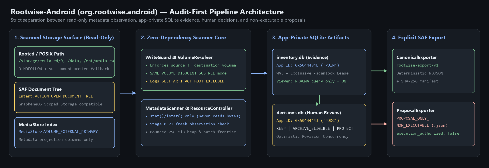
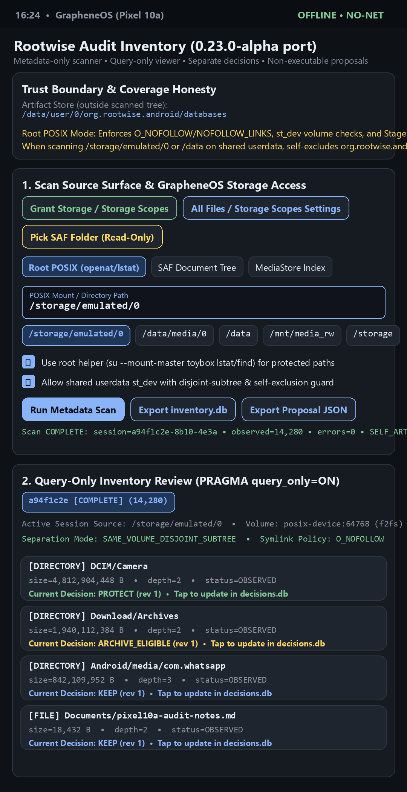
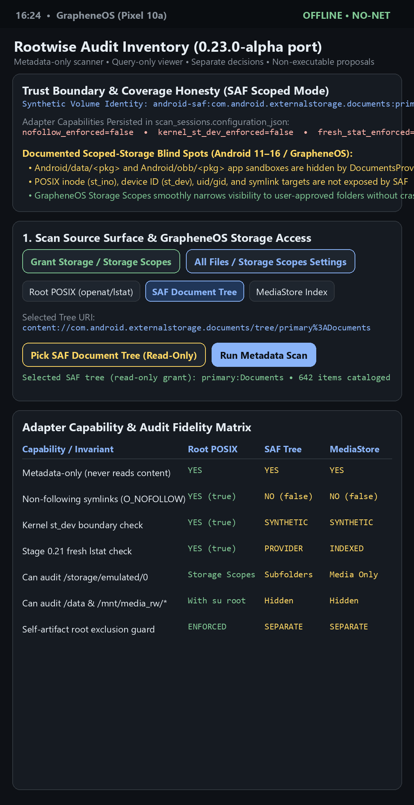
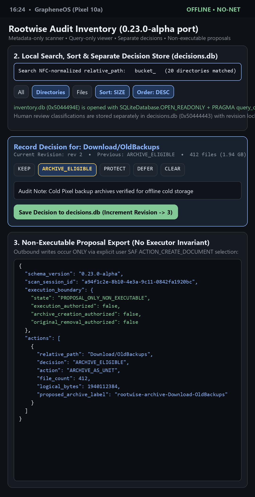

# Rootwise for Android (`org.rootwise.android`) — F-Droid & GrapheneOS Overview

**Rootwise for Android** is a native Kotlin, 100% offline, **audit-first storage inventory and non-executing review tool** built for **GrapheneOS (Pixel hardware)** and **rooted Android devices**, packaged for **F-Droid**.

- **Repository & Branch**: [`sporemound/rootwise` (`feat/android-fdroid`)](https://github.com/sporemound/rootwise/tree/feat/android-fdroid)
- **Direct APK Download (Signed Release)**: [`rootwise-android-0.23.0-alpha.apk`](https://github.com/sporemound/rootwise/releases/download/v0.23.0-alpha-android.1/rootwise-android-0.23.0-alpha.apk)
- **License**: `MIT` (zero proprietary libraries, zero network dependencies)

---

## 1. Architecture & Pipeline Diagram (PNG)

---

## 2. UI Screenshots (PNG)

### A. Scan Surface, GrapheneOS Storage Scopes & Rooted POSIX Controls

### B. SAF Document Tree Mode, Capability Flags & Blind-Spot Honesty

### C. Local Inventory Search, Separate Decision Store & Non-Executable Proposal JSON

---

## 3. What Rootwise for F-Droid Does

Most storage cleaners combine scanning and deletion in a single opaque pass, reading file contents and mutating the filesystem on the fly. **Rootwise separates evidence collection, human review, and planning into strictly isolated stages:**

1. **Metadata-Only Scanning**: Inspects `stat()`/`lstat()` fields only (`logical_bytes`, `modified_ns`, `created_ns`, `accessed_ns`, `entry_type`, `depth`). Never opens file streams or hashes file contents.
2. **Bounded Inventory Outside Scanned Volume**: Working SQLite databases live in app-private storage (`context.getDatabasePath()`). When scanning `/storage/emulated/0` or `/data` on a shared `userdata` partition, `WriteGuard` enforces `SAME_VOLUME_DISJOINT_SUBTREE`, hard-excluding `org.rootwise.android` private directories and logging `SELF_ARTIFACT_ROOT_EXCLUDED` in `scan_events`.
3. **Query-Only Review**: `InventoryReader` opens `inventory.db` in read-only mode with `PRAGMA query_only=ON` and validates `PRAGMA application_id = 1346654806` (`"PDIN"`).
4. **Separate Human Decisions**: Review classifications (`KEEP`, `ARCHIVE_ELIGIBLE`, `PROTECT`, `DEFER`, `CLEAR`) are stored in a separate SQLite file (`decisions.db`, `PRAGMA application_id = 1346654807` / `"PDDC"`) with optimistic concurrency revision checks and full append-only audit history.
5. **No Executor**: Contains zero file deletion, archiving, or move code. Exports a non-executable JSON planning proposal (`"state": "PROPOSAL_ONLY_NON_EXECUTABLE"`, `"execution_authorized": false`).
6. **Zero 3rd-Party Core Dependencies & Zero Network**: `org.rootwise.android.core.*` uses only the Kotlin standard library and platform SQLite/NIO APIs. `android.permission.INTERNET` is stripped from the manifest via `tools:node="remove"`.
